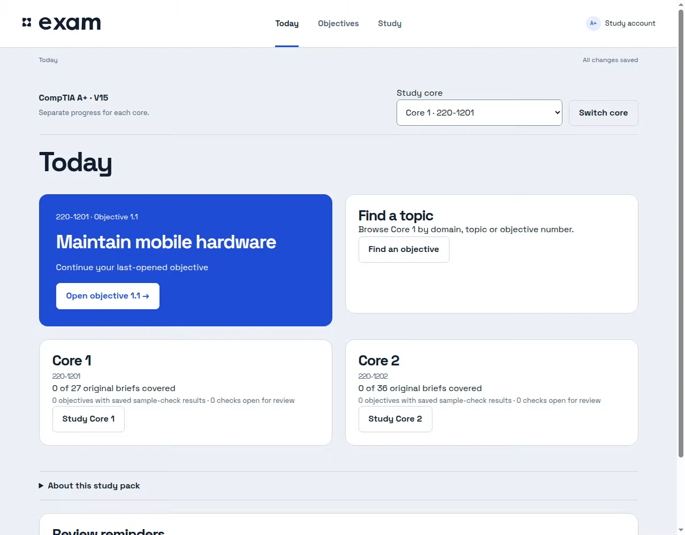
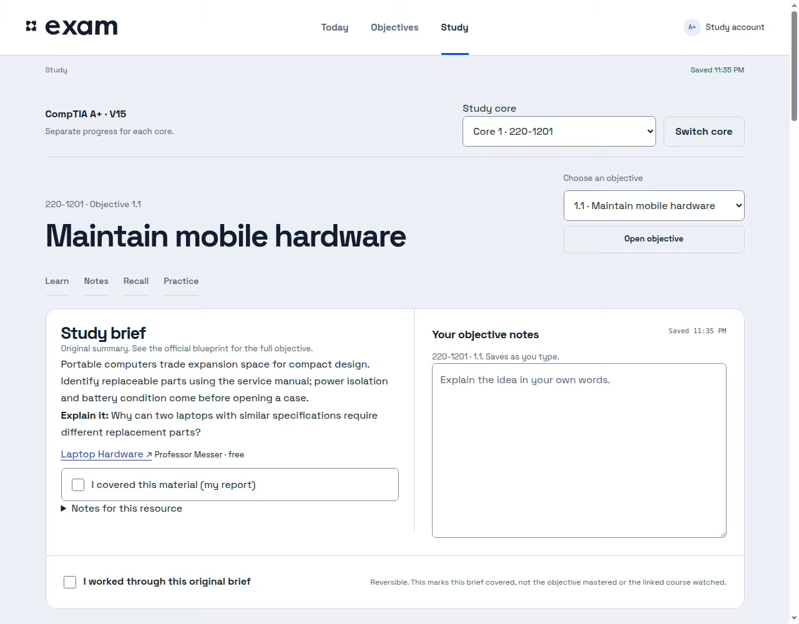
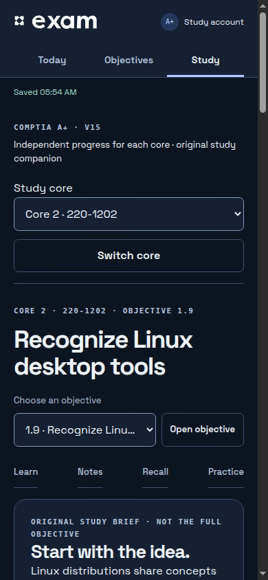

<p align="center">
  <picture>
    <source media="(prefers-color-scheme: dark)" srcset="web/assets/exam-wordmark-white.svg">
    
  </picture>
</p>
<h1 align="center">Your A+ study room.</h1>
<p align="center">Two cores. Your notes. A clearer next step.<br>A private, self-hosted study companion for CompTIA A+ V15.</p>
<p align="center"><a href="#quick-start">Get started</a> · <a href="#a-study-session-that-stays-with-you">Study flow</a> · <a href="docs/DEPLOYMENT.md">Deployment & backups</a> · <a href="docs/CONTENT.md">Content & rights</a></p>
<p align="center"><a href="https://github.com/notbdot/exam-aplus/actions/workflows/ci.yml"></a> · <a href="LICENSE">MIT license</a> · Node 22</p>



**exam · A+ edition** helps one learner work through **Core 1 (220-1201)** and **Core 2 (220-1202)** without losing their notes or place. It is a standalone app with its own account and data volume—not a replacement for another exam installation.

- **Keep the cores separate.** Independent notes, coverage and last-opened objectives, with a clear core/exam label wherever you work.
- **Find the next useful thing.** Browse objectives by domain, search a topic, continue a brief or revisit an open reminder.
- **Learn, recall, try.** Verified Professor Messer links, original sample checks with explanations, and safe scenario worksheets.
- **Keep your work.** Autosave, revision-conflict recovery, draft downloads, JSON/Markdown exports and a private persistent volume.

Node 22 · Vanilla JavaScript · No runtime npm dependencies · Docker / Compose · Light & dark themes

## Quick start

**Requirements:** Git, Docker and Docker Compose v2. Each deployment is for **one personal study account**. Start with a fresh volume; do not reuse another app’s account or progress directory.

```sh
git clone https://github.com/notbdot/exam-aplus.git
cd exam-aplus
cp .env.example .env
docker compose up --build -d
docker compose exec app node tools/setup-link.mjs
```

The last command displays a **private, one-time enrollment URL**. Open it on the Docker host, choose a password of 12–256 characters and save it in your password manager. There is **no default password** or public registration. Do not share the enrollment URL or put it in logs, screenshots or Git. It expires after 30 minutes; rerun the command to renew it before enrollment.

The app opens at **http://localhost:3000** and binds only to loopback by default. Keep the exact address in `ORIGIN` consistent with the address you open. If changing the port, update both `EXAM_PORT` and `ORIGIN` in `.env`. After a restart you sign in again; your password and progress remain in the named volume.

For a remote server, use an SSH tunnel to its loopback port or configure an HTTPS reverse proxy with an exact `ORIGIN`. See the [Docker run alternative, HTTPS and security settings](docs/DEPLOYMENT.md). The account label `study` is a password-manager hint; authentication uses your password.

## A study session that stays with you

| Today | Objectives | Study |
| --- | --- | --- |
| Continue your current core or pick up a review reminder. | Search the domain/objective outline and filter open reminders or covered briefs. | Open mapped material, write notes, check recall and record practice evidence. |

**Covering material, recalling an answer and practicing a skill are different records.** A coverage mark is reversible. An answer check does not mark an objective mastered. Hands-on evidence and help level are self-reported—not an automatically verified badge.

Questions start unanswered on each visit. The latest submitted result is saved separately. Wrong or unsure answers create a review reminder for 9am on the next local calendar day. **Resolve / Reopen / Tomorrow** stay under your control; getting a later answer right does not silently resolve an existing reminder.

<details>
<summary><strong>See the Study workspace on desktop and mobile</strong></summary>





Screenshots come from the running app with invented study data. No real learner notes or credentials are shown.
</details>

## What is included—and what is not

| Included in this content pack | Scope |
| --- | --- |
| Both numbered objective outlines | 27 Core 1 and 36 Core 2 objectives, with original short titles and official source citations. Full blueprint bullets remain in the official PDFs. |
| 136 mapped public lesson links | 62 non-introduction Core 1 lessons and 74 Core 2 lessons from Professor Messer’s course indexes. Videos open externally. |
| 63 original brief/recall prompts | Short orientation, not a replacement for instruction on every objective. |
| 18 original sample questions | Two per domain, covering selected fragments only. Explanations and saved review reminders; **not a complete question bank or mock exam**. |
| Nine shared domain worksheets | Safe tabletop/guided practice reused within each domain; **not 63 labs or a full PBQ simulator**. |

There is no predicted pass probability, readiness percentage or conversion of accuracy into CompTIA’s scaled score. Practice gaps stay visible. Docker hosts the study app; it does not provide a Windows/macOS lab environment.

**Version check:** V15, **220-1201 / 220-1202**, checked 2026-11-04 against official objective PDFs revision 4.0 and aligned provider indexes. Use both exams from the same series. Exact retirement date and the newest objective revision were not confirmed; check CompTIA before booking. [Source details and limitations →](docs/CONTENT.md)

## Bring the right materials

The default is Professor Messer’s public [Core 1 course](https://www.professormesser.com/free-a-plus-training/220-1201/220-1201-video/220-1201-training-course/) and [Core 2 course](https://www.professormesser.com/free-a-plus-training/220-1202/220-1202-video/220-1202-training-course/), alongside the official objective checklist. Links are mapped by provider headings; that does not certify complete instruction or assessment coverage.

No paid notes, practice-exam PDFs, transcripts, downloaded videos or exam dumps are included. Licensed material stays with its owner. You can configure additional links or an authenticated, read-only private-file mount without putting those files into Git or an image. [Resource configuration and private-material boundaries →](docs/RESOURCES.md)

CompTIA and Professor Messer names identify third-party exams and resources. **This project is not affiliated with or endorsed by either.**

## Own your data

- **Persistence:** one named volume contains account and progress data. One app process writes to each volume.
- **Recovery:** failed saves retain the draft in the tab; retry transient errors or download the draft before leaving. Conflicts refuse stale writes.
- **Export:** Study → General notes & export/import downloads two-core JSON progress or Markdown notes. JSON may include unsaved local edits; it is not a full account backup.
- **Backups and updates:** stop the writer for a consistent full-volume backup; rehearse restore into a separate volume. Normal compatible-image rollback retains newer progress.

[Backup / restore / update runbook →](docs/DEPLOYMENT.md#backup-restore-update-and-rollback)

## Development and verification

```sh
node --test tests/*.test.mjs
# Or, with npm available:
npm test
docker build -t exam-aplus:test .
node tools/docker-smoke.mjs exam-aplus:test
```

The Docker smoke test creates and cleans its own disposable containers/volumes. It checks fresh enrollment, two-core saves, persistent reviews, restart/re-login and independent backup restoration. Never point tests at a live volume.

The GitHub Actions workflow checks Node tests, Compose configuration, Docker build and the lifecycle smoke test. No automatic deployment or image-registry publication is configured. [Workflow →](.github/workflows/ci.yml)

Run without Docker for local development:

```sh
PORT=3000 DATA_DIR=./data ORIGIN=http://localhost:3000 node server.mjs
# In another terminal, retrieve the private setup link:
DATA_DIR=./data ORIGIN=http://localhost:3000 node tools/setup-link.mjs
```

## Limits and license

Single account, single instance; no account sync, password-reset email, proctoring, full attempt-history audit or automated grading of practical work. Browser checks use Chromium emulation, not physical-device or screen-reader certification. External provider playback, licensing and access remain with the provider.

The repository’s existing [MIT license](LICENSE) applies to its code and original content. The bundled Space Grotesk font retains its [SIL Open Font License](web/fonts/OFL-SpaceGrotesk.txt). Third-party course materials and trademarks are not relicensed by this project. [Provenance and rights →](docs/CONTENT.md)
